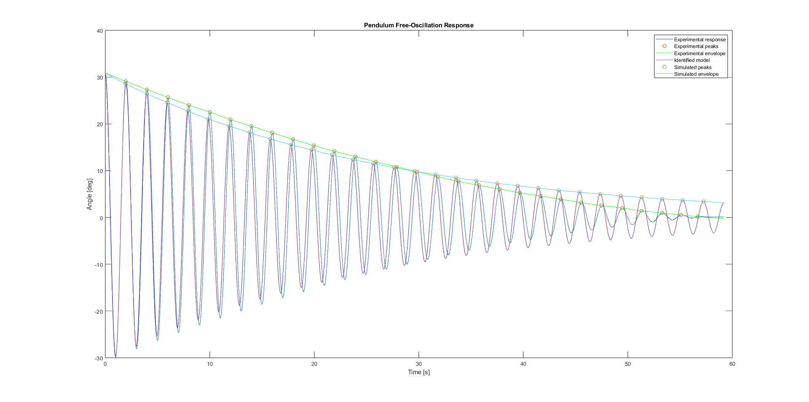
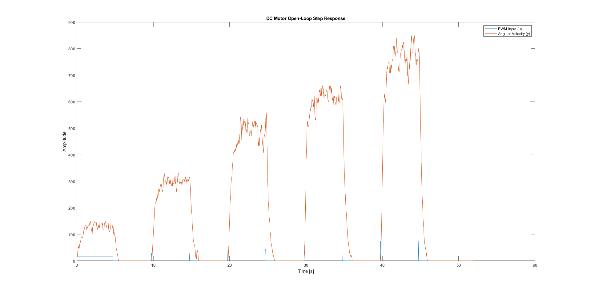
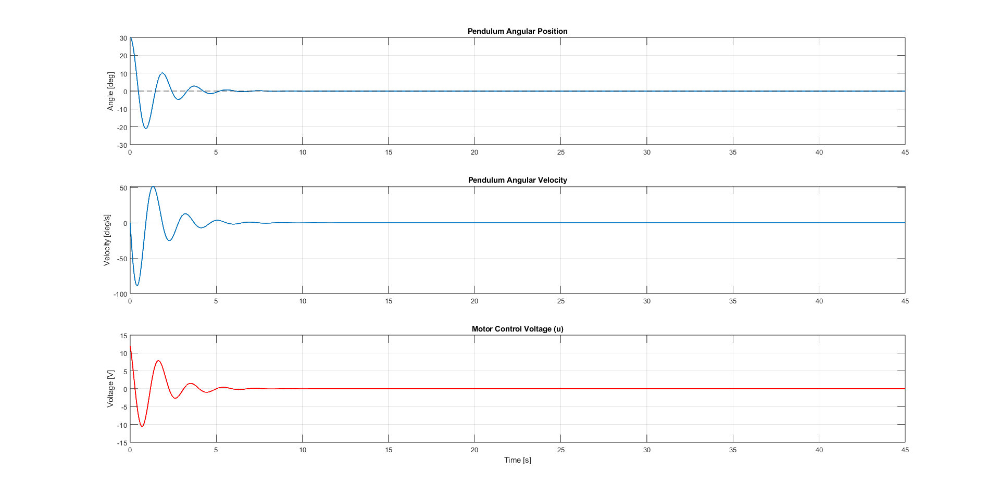
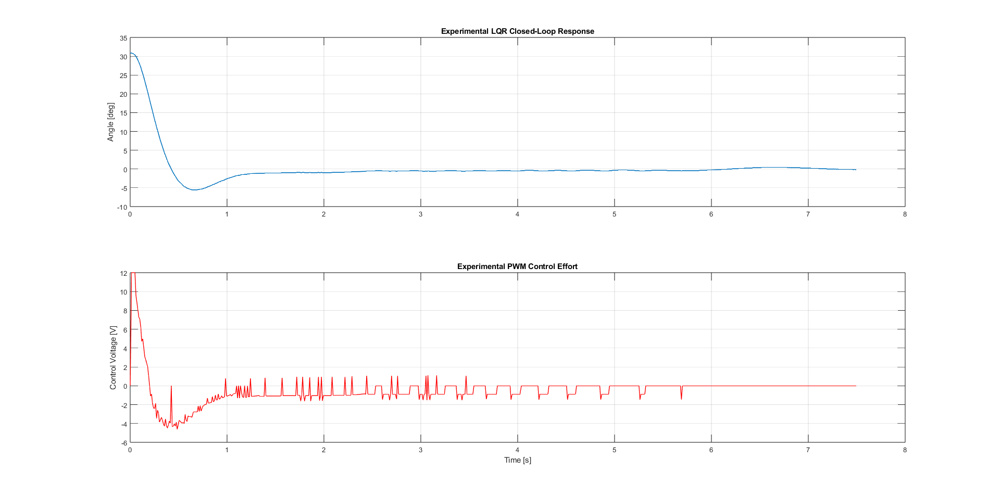

# Reaction-Wheel Pendulum: Modeling, Identification, and LQR Control

Design, experimental parameter identification, MATLAB simulation, and real-time embedded implementation of a Linear Quadratic Regulator (LQR) for a reaction-wheel pendulum.

---

## 1. Hardware Architecture

* **Microcontroller:** ESP32 (100 Hz real-time control loop, Wi-Fi Access Point web UI, and SPIFFS CSV telemetry)
* **Actuator & Power Stage:** Brushed DC motor coupled with a reaction wheel, driven via an **IBT-2 (BTS7960) H-Bridge** (PWM actuation on GPIO 25/26, $\pm 12\text{ V}$ supply limit)
* **Sensors:**
  * **AS5600** 12-bit contactless magnetic rotary position sensor over I2C (SDA: GPIO 21, SCL: GPIO 22) for pendulum angle $\theta$
  * **FC-03** optical slotted encoder (GPIO 15, 4 slots/rev) for flywheel angular velocity $\dot{\alpha}$

---

## 2. System Modeling & Experimental Identification

The nonlinear dynamics of the reaction-wheel pendulum were linearized into a 4-state space representation:

$$x = \begin{bmatrix} \theta & \dot{\theta} & \alpha & \dot{\alpha} \end{bmatrix}^T$$

Unknown mechanical and electromechanical parameters were experimentally identified in MATLAB (`matlab/pendulum_lqr_control.m`) from datasets acquired directly on the physical plant:

* **Pendulum Identification (`matlab/data/angle_identification.csv`):** Given pendulum mass $M_p = 0.1464\text{ kg}$ and center-of-mass distance $d_m = 0.135\text{ m}$, total moment of inertia $J$ and pivot viscous friction $b_\theta$ were estimated via logarithmic decrement regression on free-oscillation decay peaks.
* **Motor & Flywheel Identification (`matlab/data/motor_identification.csv`):** Using datasheet electrical constants ($k_e = 0.0086\text{ V}\cdot\text{s/rad}$, $k_m = 0.00971\text{ N}\cdot\text{m/A}$, $R_a = 3.08\ \Omega$), flywheel inertia $J_w$ and viscous friction $b_\alpha$ were derived from a first-order transfer function fit (`tfest`) on open-loop PWM step responses.

| Pendulum Free-Oscillation Fit | DC Motor Open-Loop Step Response |
| :---: | :---: |
|  |  |

---

## 3. LQR Control Design & Simulation

An infinite-horizon LQR state-feedback controller ($u = -Kx$) was synthesized in MATLAB by iteratively sweeping the angular position weight $q_\theta$ to maximize stabilization speed while keeping the peak control effort within the **$\pm 12\text{ V}$** H-bridge saturation limit at a $30^\circ$ initial deflection.



---

## 4. Embedded Implementation & Experimental Validation

The control law was deployed on the ESP32 (`firmware/lqr_controller/lqr_controller.ino`) with a built-in web interface for live gain tuning ($K_1 \dots K_4$), zero-reference calibration, and onboard SPIFFS logging (`matlab/data/closed_loop_lqr.csv`).

* **Sim-to-Real Correlation:** Experimental closed-loop stabilization matches the linearized MATLAB model within the valid operating region.
* **Quantization Noise Diagnosis:** Differentiating discrete optical encoder counts introduces high-frequency control chatter amplified by the feedback gain $K$, illustrating the practical trade-off between derivative bandwidth and PWM actuation smoothness.



---

## 5. Repository Structure

```text
├── docs/
│   ├── dc_motor_open-loop_step_response.png
│   ├── lqr_closed-loop_plot.png
│   ├── pendulum_free_oscillation_response.png
│   └── position_velocity_pwm_plot.png
├── firmware/
│   ├── angle_identification/
│   │   └── angle_identification.ino
│   ├── lqr_controller/
│   │   └── lqr_controller.ino
│   └── motor_identification/
│       └── motor_identification.ino
├── matlab/
│   ├── data/
│   │   ├── angle_identification.csv
│   │   ├── closed_loop_lqr.csv
│   │   └── motor_identification.csv
│   └── pendulum_lqr_control.m
├── .gitignore
└── README.md
```